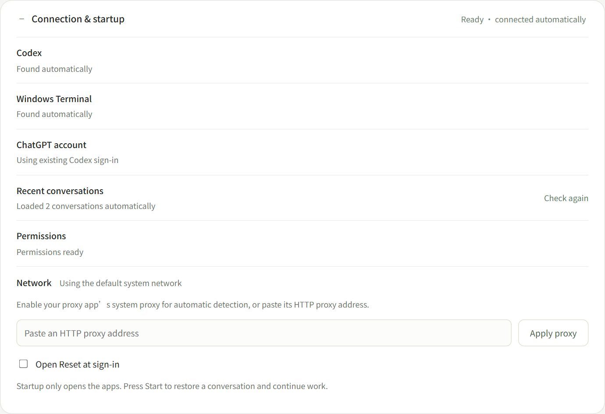
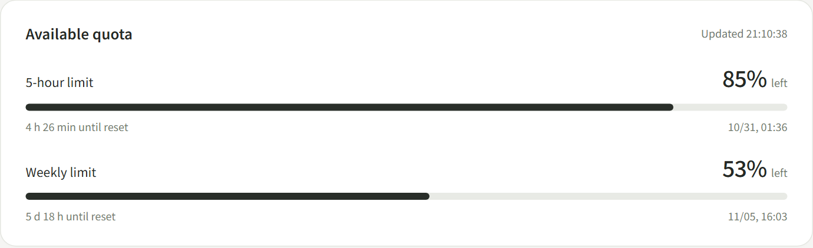
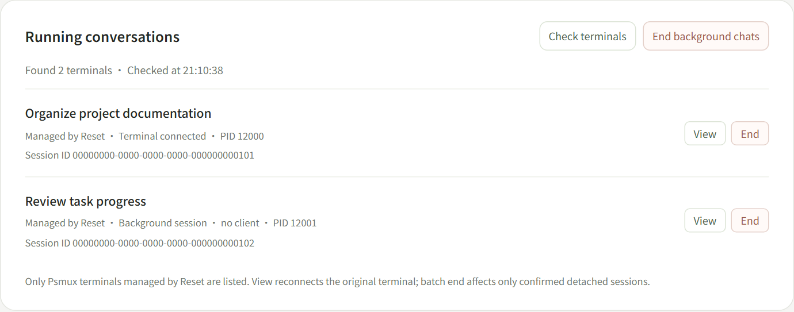
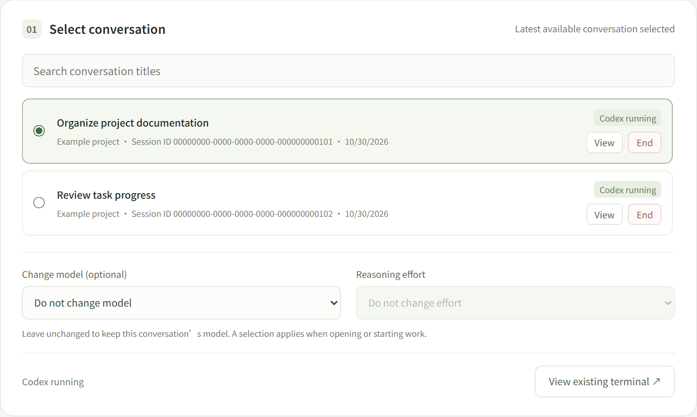
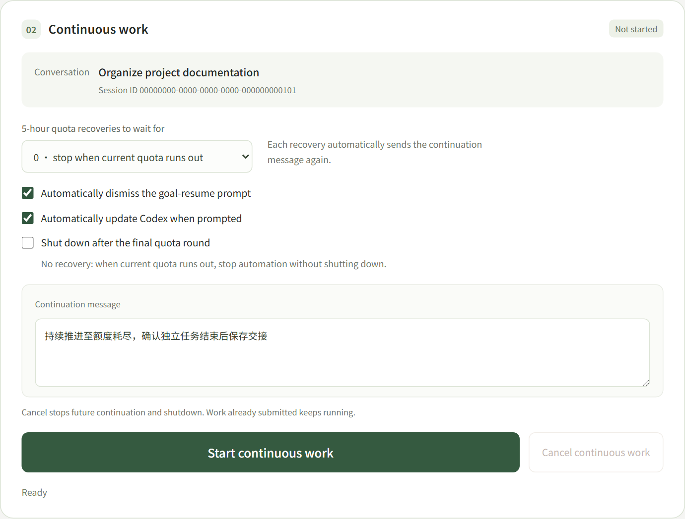

# Reset-codex

English | [简体中文](README.zh-CN.md)

Reset is a Windows 11 tool for checking Codex quota and continuing tasks. View remaining quota, open existing conversations, and continue work after quota recovery. The interface defaults to Chinese and also supports English.

## Get started

[Download the Windows x64 portable package](release/Reset-codex-windows-x64.zip), extract it, and double-click `Reset.exe`. Keep the helper executable and `_internal` alongside it. Python and Psmux are included.

Reset checks for Codex, an existing sign-in, and recent local conversations automatically. The sections below follow the interface order.

Screenshots below use example data.

## 0. Connection & startup



Click **＋** to expand this section. Check Codex, Windows Terminal, sign-in and permissions here. Install a missing program or select an existing installation. Click **Sign in with ChatGPT** if needed; an existing Codex sign-in is reused.

Enable **Open Reset at sign-in** to start the app after Windows login. This opens Reset only. It does not restore a chat or submit a task.

## 1. Available quota



Check the five-hour and weekly limits here. Progress bars show what remains, with estimated reset times. Click **Refresh quota** in the top-right corner to check again.

Local conversations still appear if quota is temporarily unavailable.

## 2. Running conversations



This section lists terminals managed by Reset through Psmux, with conversation titles, session IDs, PIDs and connection status. **View** returns to the existing terminal. **End** closes that terminal and stops its continuation controller; saved conversation history remains.

Click **Check terminals** to refresh the list. **End background chats** closes only confirmed detached sessions and asks for confirmation first. Ordinary terminals opened outside Reset are not included in this managed list.

## 3. Select conversation



The most recent usable conversation is selected by default. Search by title or session ID, select a conversation, and click **View**. Codex opens in a black Windows Terminal window, managed by Psmux. VS Code is not required.

If the conversation is already running in Reset, View reconnects it rather than opening another copy. If the same session is identified in an external terminal, Reset asks you to close the original Codex before opening it here.

Choose a model here if you want to change it. Leave the selector unchanged to keep the conversation's own model.

## 4. Continuous work



Click **Start continuous work** to send a continuation instruction to the selected Codex conversation. Reset presses Enter automatically. The **Continuation message** field is prefilled and editable, up to 2000 characters:

> 持续推进至额度耗尽，确认独立任务结束后保存交接

The default asks Codex to continue until quota exhaustion and save a handoff after completing independent tasks. You can replace it with an instruction in your own language.

Codex may show a goal-resume or update prompt when a chat opens. Both handling options are checked by default:

- **Automatically dismiss the goal-resume prompt:** select `Leave paused`, then send the message.
- **Automatically update Codex when prompted:** update, reopen the original conversation, then send the message.

Uncheck an option to handle that prompt yourself in the terminal, then click **Start continuous work**.

The recovery count defaults to **0**: stop automation when the current quota runs out. Choose **1** to wait for one recovery and continue for another round, or **2** for two recoveries. Each round uses the configured message, and recovery must be confirmed before it is sent.

Enable **Shut down after the final quota round** if needed. With 0 recoveries, shutdown follows the current round. With 1, it follows the final round after one recovery. Reset waits for an idle terminal, then starts a cancellable 60-second countdown.

Click **Cancel continuous work** at any time to stop future continuation and shutdown. Work already submitted keeps running in Codex. Use the conversation's **End** button to close its terminal.

## 5. Network settings

Network settings are optional. A proxy is not required. Reset follows existing local settings and connects directly when no proxy is configured. Enter a host and port only if a proxy is needed and automatic detection did not find it.

Use the top-right language selector to switch between Chinese and English.

## A few things to know

Reset keeps the computer awake during continuous work. Closing the last frontend terminal ends its Psmux backend; minimizing does not. Reopening Reset does not automatically start work.

A complete real-account exhaustion, wait and recovery cycle, an actual update, and automatic shutdown still need further live validation. See [Validation scope](VALIDATION.md). Reset reports conditions it cannot confirm rather than repeatedly acting on them. System permissions and custom data directories can also limit external-session detection.

## Local data and privacy

Personal configuration is stored in `%LOCALAPPDATA%/Reset/config.local.json`, with runtime and interface data in the local application-data directory. Continuation messages and checkbox settings are stored in local continuous-mode state, not public defaults or portable-package resources. A `config.local.json` alongside the app is also supported; application-data overrides take precedence.

Quota, models and recent conversation titles come from the local official Codex app-server without directly opening authentication files. Prompt handling and submission verification capture the selected Psmux terminal's visible screen locally, which may contain conversation text. Reset does not upload those captures or save them as logs. Instructions submitted to Codex are processed by official Codex through its normal operation.

Do not commit personal configuration, authentication files, browser data, runtime records or personal progress notes. Ignore rules and a public-content audit are included.

| Advanced setting | Purpose |
|---|---|
| `codex_path`, `windows_terminal_path`, `browser_path`, `psmux_path` | Locate executables if automatic discovery fails. |
| `workspace` | Leave blank for all local CLI conversations or filter by working directory. |
| `thread_id` | Optional default conversation; blank selects the most recent usable one. |
| `language` | `zh` or `en`; interface selection is remembered locally. |
| `recovery_limit` | Default recovery count, from 0 to 100. |
| `proxy_host`, `proxy_port` | Optional; fill both or leave blank for discovery or direct access. |
| `require_admin` | Check administrator permissions and actual Windows integrity level. |
| `startup_delay_seconds` | Delay after Windows sign-in, default 10 seconds. |

## Development and fallback commands

Windows 11 x64 and Python 3.11 or later are required for source development. An isolated Conda environment is recommended. The portable package includes Python 3.12.

Run from source:

```powershell
python -m pip install -r requirements.txt
python -B main.py
```

Build a new portable directory:

```powershell
python -m pip install -r requirements-build.txt
python -B build.py
```

The output is `release/Reset`. The build does not overwrite an existing output directory; use `--output` to choose a new one. `Reset.exe` is the desktop entry point. `ResetTerminal.exe` preserves native terminal input and output. Both use the same control logic.

These commands are alternatives to the interface controls:

```powershell
.\ResetTerminal.exe --diagnose
.\Reset.exe --install-startup
.\Reset.exe --disable-startup
```

Permission repair is also available from an elevated terminal:

```powershell
powershell.exe -NoProfile -ExecutionPolicy Bypass -File .\repair-permissions.ps1
```

The repair adjusts integrity labels on this application's executables only. It does not recursively modify directories, relax profile-directory ACLs, or change the Codex sandbox. The script verifies the Psmux signature. Integrity labels belong to the local filesystem: newly built or copied files can inherit restrictions from their destination. Repairing an old copy does not automatically repair a new copy, but repair is not required on every launch.

Run the automated checks and public-content audit:

```powershell
python -B -m unittest discover -s tests -q
python -B audit_public.py
```

Automated checks cover the state machine, cancellation, network discovery, configuration, and interface behavior. A complete real-account quota exhaustion, wait, and recovery cycle still requires live acceptance. If a Codex update changes the native interaction format, Reset stops for review.

## License

Project source is available under the MIT license. Third-party components retain their respective licenses; see [THIRD_PARTY_NOTICES.md](THIRD_PARTY_NOTICES.md). Reset-codex is an independent project and is not an official OpenAI application.

