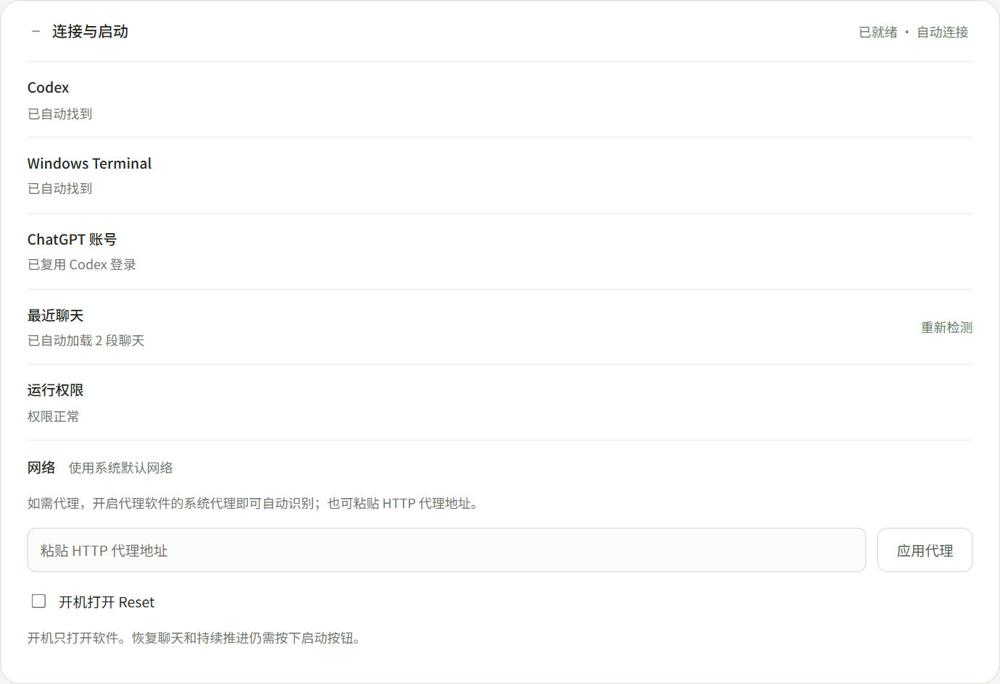
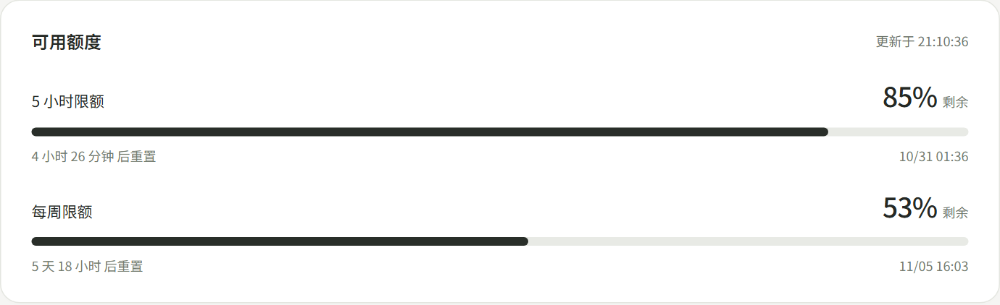
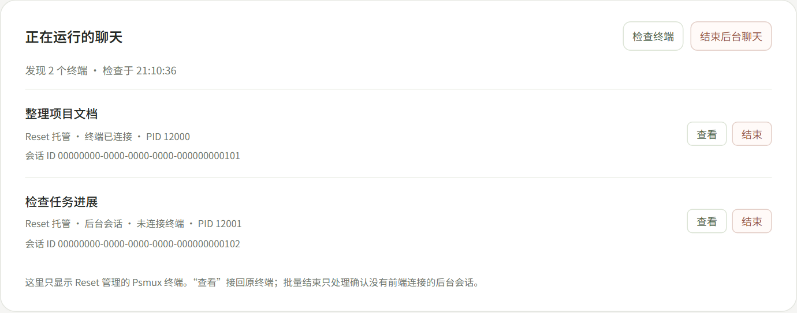
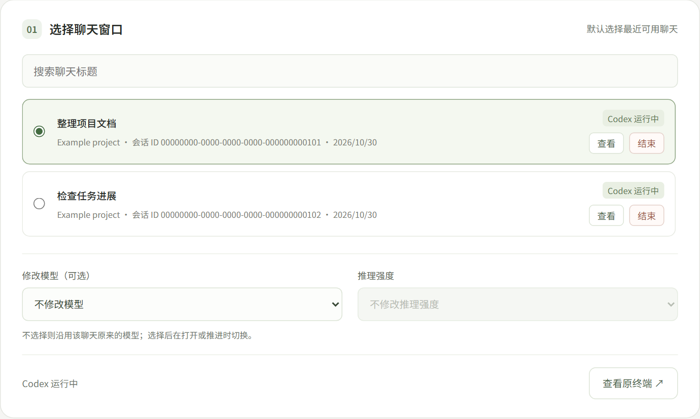
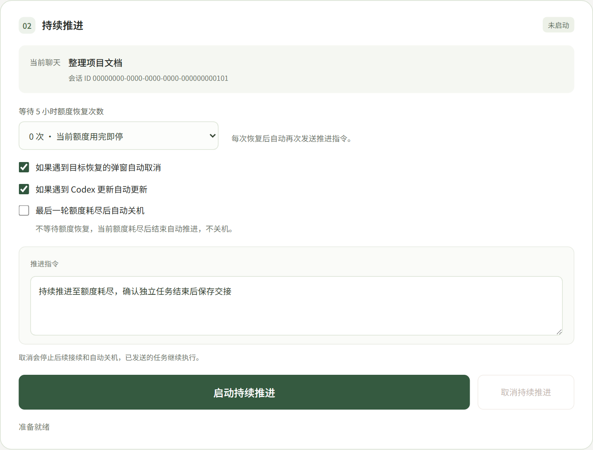

# Reset-codex

[English](README.md) | 简体中文

Reset 是一个 Windows 11 上的 Codex 额度查看和任务接续工具。可以看额度、打开已有聊天，也可以在额度恢复后自动继续任务。默认中文，支持英文。

## 开始使用

[下载 Windows x64 便携包](release/Reset-codex-windows-x64.zip)，解压后双击 `Reset.exe`。同目录的辅助程序和 `_internal` 要保留，Python 和 Psmux 已经包含在里面。

软件会自动检测本机 Codex、已有登录和最近聊天。下面按界面的顺序介绍。

以下截图使用示例数据。

## 0. 连接与启动



点击前面的 **＋** 可以展开，查看 Codex、Windows Terminal、账号登录和运行权限。缺少程序可以安装或选择已有程序，没有登录可以点击“登录 ChatGPT”。已有的 Codex 登录会直接复用。

需要开机启动就勾选“开机打开 Reset”。开机只打开软件，不会直接恢复聊天或发送任务。

## 1. 可用额度



这里可以看 5 小时额度和每周额度，进度条显示还剩多少，同时显示预计恢复时间。点右上角“刷新额度”可以重新查询。

额度暂时查不到时，本机已有聊天仍然会显示。

## 2. 正在运行的聊天



这里显示 Reset 通过 Psmux 管理的终端，包括聊天标题、会话 ID、PID 和连接状态。点“查看”会接回原终端，点“结束”会关闭这个终端并停止它的持续推进，已经保存的聊天记录会保留。

点“检查终端”可以重新检查。“结束后台聊天”只关闭确认没有前端连接的后台会话，关闭前会让用户确认。手动在其他地方打开的普通终端不在这个托管列表里。

## 3. 选择聊天窗口



默认选最近可用的聊天，也可以按标题或会话 ID 搜索。选好后点“查看”，就会在黑色 Windows Terminal 窗口里打开 Codex 聊天，终端由 Psmux 管理，不需要 VS Code。

已经在 Reset 中运行的会话会直接接回，不会再开一份。如果识别到同一会话在用户自己打开的其他终端里运行，会提示先关闭原 Codex，再从 Reset 打开。

想换模型可以在这里选择；不选就沿用该聊天原来的模型。

## 4. 持续推进



直接点“启动持续推进”，软件就会给选中的 Codex 聊天发送一条继续任务的指令，并自动回车。默认指令已经填好，也可以在软件的“推进指令”输入框里修改，最多 2000 字：

> 持续推进至额度耗尽，确认独立任务结束后保存交接

打开聊天时，Codex 可能弹出目标恢复或更新提示。下面两项默认勾选：

- **如果遇到目标恢复的弹窗自动取消**：选择 `Leave paused`，再发送指令。
- **如果遇到 Codex 更新自动更新**：更新成功后重新进入原来的聊天，再发送指令。

不想自动处理就取消勾选，自己在终端里处理完提示，再点“启动持续推进”。

“等待 5 小时额度恢复次数”默认是 **0 次**，当前额度用完就停止自动推进。选 **1 次**，就等额度恢复一次，再继续一轮；选 2 次就是恢复两次。每次继续都使用输入框里设置的指令，只有确认额度恢复后才会发送。

想在最后一轮额度耗尽后关机，就勾选“最后一轮额度耗尽后自动关机”。选 0 次就是当前额度用完后关机；选 1 次就是等一次恢复，再用完最后一轮后关机。软件会等终端空闲，再开始 60 秒可取消的倒计时。

随时可以点“取消持续推进”，停止后续接续和自动关机。已经发送的任务仍会在 Codex 里执行，要结束终端可以用聊天对应的“结束”按钮。

## 5. 网络设置

网络设置是可选的，不强制使用代理。软件会优先跟随本机已有设置，没有代理就直接连接。确实需要代理又没自动检测到时，再填写地址和端口。

界面右上角可以切换中文和英文。

## 使用时注意

持续推进时软件会保持电脑唤醒。关闭聊天最后一个前端终端，会结束对应的 Psmux 后台会话；最小化不会。重新打开 Reset 不会自动开始任务。

完整的真实额度耗尽、等待和恢复流程，以及实际更新和关机流程，仍需进一步验证，见 [验证范围](VALIDATION.md)。终端状态、更新结果或指令发送无法确认时，软件会提示处理，不会一直重复操作。外部会话识别也可能受到系统权限和自定义数据目录的影响。

## 本机数据与隐私

个人配置位于 `%LOCALAPPDATA%/Reset/config.local.json`，运行状态和界面数据也保存在本机应用数据目录。推进指令和勾选项保存在本机的持续推进状态中，不写入公开默认配置或便携包。同目录 `config.local.json` 仍可作为高级覆盖配置；用户应用数据目录中的配置优先。

额度、模型和最近聊天标题通过本机官方 Codex app-server 获取，不直接读取认证文件。自动处理终端弹窗和验证发送时，会在本机读取所选 Psmux 终端的可见屏幕，其中可能包含聊天正文；Reset 不将这些捕获内容上传或保存为日志。发送给 Codex 的指令由官方 Codex 按其正常机制处理。

不要提交个人配置、登录文件、浏览器数据、运行记录或个人进展文档。仓库提供忽略规则和公开内容检查。

| 高级设置 | 说明 |
|---|---|
| `codex_path`、`windows_terminal_path`、`browser_path`、`psmux_path` | 自动发现失败时指定程序路径 |
| `workspace` | 留空显示全部本机 CLI 聊天；填写后按目录过滤 |
| `thread_id` | 可选默认聊天；留空选择最近可用聊天 |
| `language` | `zh` 或 `en`；界面选择在本机记忆 |
| `recovery_limit` | 默认等待恢复次数，0–100 |
| `proxy_host`、`proxy_port` | 可选，两项同时填写；留空自动发现或直接连接 |
| `require_admin` | 检查管理员权限和实际完整性级别 |
| `startup_delay_seconds` | 开机启动延迟，默认 10 秒 |

## 开发与备用命令

Windows 11 x64，Python 3.11 或更新版本。建议使用独立 Conda 环境。附带便携包使用 Python 3.12。

从源码运行：

```powershell
python -m pip install -r requirements.txt
python -B main.py
```

构建新的便携目录：

```powershell
python -m pip install -r requirements-build.txt
python -B build.py
```

输出为 `release/Reset`。构建命令不覆盖已有目录，可用 `--output` 指定新的输出位置。`Reset.exe` 是桌面入口，`ResetTerminal.exe` 用于保留原生终端输入输出，二者共享控制逻辑。

以下命令是界面操作的备用方式：

```powershell
.\ResetTerminal.exe --diagnose
.\Reset.exe --install-startup
.\Reset.exe --disable-startup
```

权限修复备用方式：

```powershell
powershell.exe -NoProfile -ExecutionPolicy Bypass -File .\repair-permissions.ps1
```

修复仅调整本软件可执行文件的完整性标记，不递归修改目录、不放宽用户目录 ACL、不修改 Codex 沙箱。脚本核验 Psmux 签名。安全标签属于本地文件系统；新生成或复制的文件可能继承目标目录的限制，修过旧副本不等于新副本已修复，也不是每次启动都要重复修复。

验证源码与公开内容：

```powershell
python -B -m unittest discover -s tests -q
python -B audit_public.py
```

状态机、取消、网络发现、配置和界面有自动化检查；完整的真实额度耗尽、等待和恢复周期仍需实机验收。Codex 升级若改变原生交互格式，软件会停止等待处理。

## 许可证

项目源码使用 MIT 许可证。第三方组件保留各自许可，见 `THIRD_PARTY_NOTICES.md`。Reset-codex 为独立项目，并非 OpenAI 官方应用。


